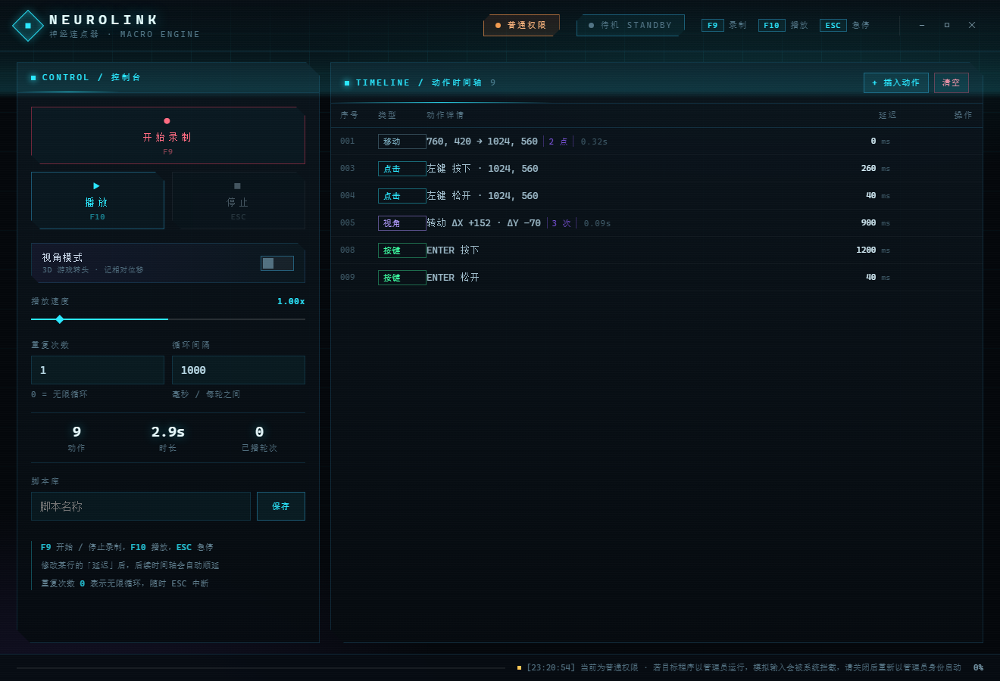
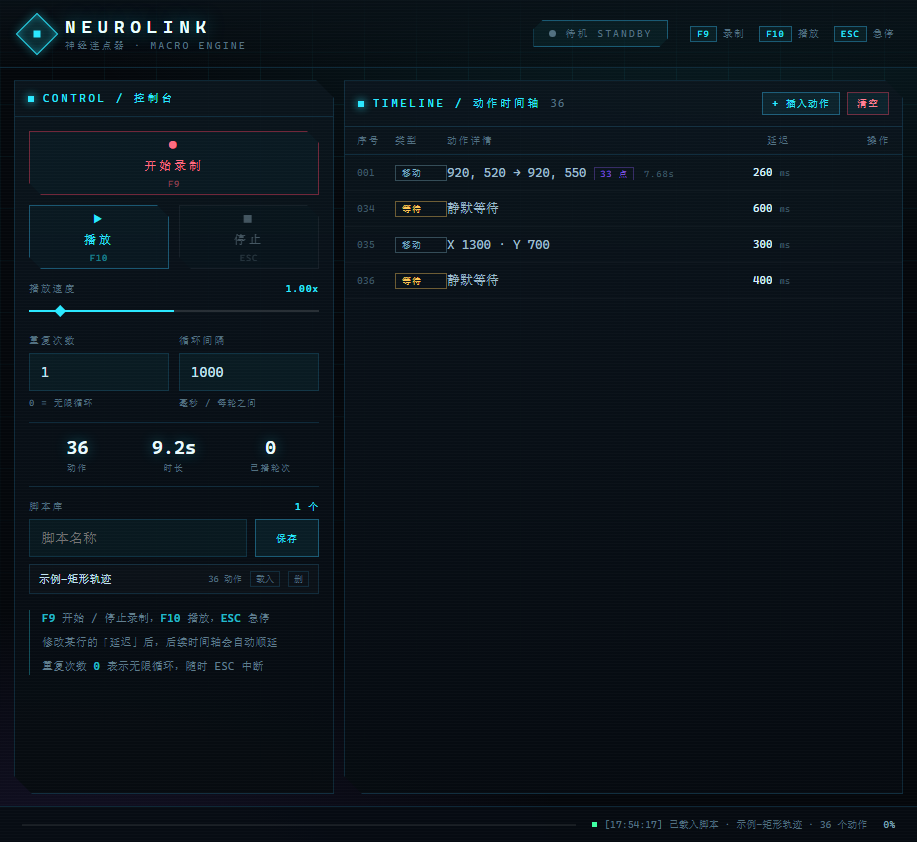

<div align="center">

# NEUROLINK · 神经连点器

**录制一次操作，按时间轴原样回放。倍速、重复、逐条编辑，全部在一个原生窗口里完成。**

Windows 全局鼠标 / 键盘动作录制与回放工具 · 3D 游戏视角模式 · 无边框科幻控制台 · 零外部依赖

[](https://www.python.org/)
[](#系统要求)
[](#零依赖)
[](LICENSE)
[](https://github.com/Susky0-o/neurolink-clicker/stargazers)



<a href="#快速开始">快速开始</a> · <a href="#功能">功能</a> · <a href="#视角模式3d-游戏专用">视角模式</a> · <a href="#技术实现">技术实现</a> · <a href="#常见问题">常见问题</a> · <a href="#参与贡献">参与贡献</a>

<sub>English: NEUROLINK Clicker is a Windows macro recorder & replayer with a themed, frameless console UI and a raw-input "view mode" for 3D games.</sub>

</div>

---

## 这是什么

按 `F9` 录一段你在任意软件里的鼠标键盘操作，按 `F10` 按原时间轴一模一样地重放，中间还能改每一条动作的延迟、顺序、次数和速度。

和一堆「固定坐标 + 固定间隔」的连点器最大的不同：

- **录的是时间轴，不是坐标列表**。每个动作带自己的时间戳，回放节奏和录制时一致，不是机械地每 100ms 点一下。
- **能编辑**。时间轴每一行都可以改延迟、上下移动、复制、删除，也能手动插入点击 / 按键 / 滚轮 / 等待。
- **能进 3D 游戏**。视角模式走 Raw Input 相对位移，1:1 还原甩枪和转视角，不受游戏锁光标影响。
- **不装依赖**。`pynput` 直接放在 `vendor/` 里，换台机器拷过去就能跑。

## 界面

<table>
  <tr>
    <td align="center"></td>
    <td align="center"></td>
  </tr>
  <tr>
    <td align="center"><sub>左栏：录制 / 播放 / 倍速 / 重复 / 脚本库</sub></td>
    <td align="center"><sub>右栏：动作时间轴与逐条编辑</sub></td>
  </tr>
</table>

窗口是**无边框**的：没有系统标题栏，顶部那条「NEUROLINK / 权限 / 待机 / 快捷键」就是标题栏，按住空白处可拖动，双击可最大化，右上角 `—` `□` `✕` 是最小化 / 最大化 / 关闭。四边和四角有一圈很窄的热区，可拖拽改大小（最小 980×660）。

## 功能

| 能力 | 说明 |
| --- | --- |
| **全局录制** | `F9` 开始 / 结束，切到任何程序都能用；开录后 0.35s 宽限期，避免把「点录制按钮」录进去 |
| **时间轴回放** | `F10` 播放 / 停止，`ESC` 立即急停；鼠标真实移动并点击 |
| **倍速与重复** | 速度 `0.1x`–`50x`；重复 `1`–`99999` 次，`0` 为无限循环；每轮之间可设循环间隔 |
| **逐条编辑** | 改延迟（后续动作自动顺延）、`↑ ↓` 排序、`⧉` 复制、`✕` 删除、`＋` 行内插入 |
| **移动段折叠** | 连续鼠标移动自动合并成「移动 · 起点 → 终点」，只显示点数与耗时，不再一行一个坐标 |
| **插入动作** | 移动 / 点击 / 按键 / 滚轮 / 等待五类，支持只按下或只松开，用来做拖拽与长按 |
| **视角模式** | 针对 3D 游戏，按设备级相对位移录制与回放（见下文） |
| **脚本库** | 命名保存为 JSON，载入时连速度 / 重复 / 间隔一起恢复 |
| **权限自检** | exe 内嵌 `requireAdministrator` 清单，界面右上角常驻「ADMIN / 普通权限」徽标 |
| **独立窗口** | `pywebview` 拉起无边框窗口，缺了它自动退回浏览器模式，不会崩 |
| **单实例** | 已开着一个再点一次，只把旧窗口拉到前面；普通权限旧实例会被管理员进程接管 |

## 快速开始

### 方式一：下载即用

1. 下载仓库里的 `连点器.exe`、`启动连点器.bat`、`app.py`、`web/`、`vendor/`（整个项目文件夹最省事）。
2. 双击 `连点器.exe`，在 UAC 弹窗点「是」。
3. 窗口打开后按 `F9` 录制，`F10` 播放。

> `连点器.exe` 只是启动器，它会拉起同目录的 `启动连点器.bat`，所以两者必须在同一个文件夹里。

### 方式二：源码运行

```bash
git clone https://github.com/Susky0-o/neurolink-clicker.git
cd neurolink-clicker

python app.py             # 无边框独立窗口（需要 pywebview）
python app.py --browser   # 退回浏览器模式，打开 http://127.0.0.1:8765
```

- 需要 Python 3.8 以上。
- `pynput` 已随 `vendor/` 提供，不用 `pip install`。
- 想要独立窗口再装一个 `pywebview`：`pip install pywebview`。

<div id="系统要求"></div>

**系统要求**：Windows 10 / 11（依赖 Win32 `SendInput`、Raw Input、DPI API）。Linux / macOS 不可用。

### 零依赖

| 依赖 | 位置 | 说明 |
| --- | --- | --- |
| `pynput` | `vendor/pynput` | 随项目携带，不需要 pip 安装，也不走系统 site-packages |
| `pywebview` | 系统 Python | 可选。没有它时自动退回浏览器模式 |

## 快捷键

全局生效，切到别的程序也有效：

| 键 | 作用 |
| --- | --- |
| `F9` | 开始录制 / 停止录制 |
| `F10` | 开始播放 / 停止播放 |
| `ESC` | 立即急停 |

录制期间 `F9` / `F10` / `ESC` 本身不会被录进动作。

## 使用流程

1. 按 `F9`（或点「开始录制」）→ 在任意软件里正常操作 → 再按 `F9` 结束。
2. 按 `F10` 播放。播放时鼠标会真实移动并点击，请让它执行完，或按 `ESC` 急停。
3. 在「动作时间轴」里微调：
   - 每行的 `延迟` 可直接改数字（该动作距上一个动作的毫秒数），后续时间轴自动顺延；
   - 行内 `＋` 在这一行后插入动作，`↑ ↓` 调整顺序、`⧉` 复制、`✕` 删除；
   - 右上「+ 插入动作」可插入 移动 / 点击 / 按键 / 滚轮 / 等待；
   - 折叠的移动段，`⧉` 和 `✕` 作用于整段。
4. 「循环间隔」是每一轮播放结束后停顿多久再进入下一轮。

### 参数

| 参数 | 含义 |
| --- | --- |
| 播放速度 | `2.0x` 整段耗时减半，`0.5x` 放慢一倍 |
| 重复次数 | `1` 播放一遍，`0` 无限循环直到 `ESC` |
| 循环间隔 | 毫秒，`0` 表示紧接着下一轮 |

### 脚本库

录制好的动作可以命名保存到 `scripts/*.json`，下次载入即可复用，同时恢复当时的速度 / 重复 / 间隔。

仓库自带 `scripts/示例-矩形轨迹.json`（33 个鼠标移动动作，约 8 秒绕一个矩形），可以先载入、按 `F10` 感受播放效果。它只有移动没有点击，播放时不会误触任何东西。

<div id="视角模式3d-游戏专用"></div>

## 视角模式（3D 游戏专用）

普通录制记的是鼠标在屏幕上的**绝对坐标**。3D 游戏读的是鼠标**相对位移**（Raw Input），而且会把光标锁在窗口中心——按绝对坐标回放，视角就会乱转、乱飞。

打开控制台的「视角模式」开关后再录，录制与回放全程走相对位移：

- 录制时用 Raw Input 读设备级 `dx/dy`，游戏怎么读、程序就怎么记，不受光标锁定影响；
- 每一帧位移都单独保留（只合并同一毫秒内的采样），回放按原时间轴逐帧推送，播放期间把系统定时精度临时提到 1ms，节奏与录制时一致，不会「一下转到位」；
- 回放用 `SendInput` 的相对移动（不带绝对坐标），并临时关掉「提高指针精确度」，播完自动恢复；
- 时间轴里显示为紫色的「视角」段，连续转动合并成一行「转动 ΔX · ΔY · N 次」；
- 视角模式下录的点击 / 滚轮只记按下松开，不再额外挪光标。

开关在录制 / 播放中不可切换。两种模式各录各的，不要混在同一份动作里。

<div id="技术实现"></div>

## 技术实现

单进程、纯标准库 + `pynput`，没有第三方服务：

| 环节 | 做法 |
| --- | --- |
| 事件捕获 | `pynput` 全局钩子；视角模式额外注册 `RIDEV_INPUTSINK` 的 Raw Input 窗口，读 `WM_INPUT` 里的设备级位移 |
| 绝对回放 | `SendInput` 注入 `MOUSEEVENTF_MOVE \| ABSOLUTE`，并做虚拟桌面坐标归一化，多屏也能覆盖 |
| 相对回放 | `SendInput` 注入不带绝对标志的相对移动，播放前后用 `SPI_GETMOUSESPEED` / `SPI_SETMOUSESPEED` 包一层，关掉指针加速 |
| 定时精度 | 播放期间 `timeBeginPeriod(1)`，结束 `timeEndPeriod(1)` |
| 坐标一致 | 启动即 `SetProcessDpiAwareness(PER_MONITOR_AWARE_V2)`，按物理像素工作 |
| 权限 | exe 内嵌 `requireAdministrator` 清单；`bat` 自检 `net session`，权限不足自动 `RunAs` 提权重启 |
| 前后端通信 | 本地 `127.0.0.1:8765` 起的微型 HTTP 服务 + 单页控制台，端口被占用时自动顺延 |
| 单实例 | 启动先探测已有实例，管理员进程会关掉普通权限旧实例并接管 |
| 窗口 | `pywebview` 无边框窗口 + Win32 `ReleaseCapture` / `SendMessage(WM_NCLBUTTONDOWN)` 实现拖动、缩放、最大化 |

## 项目结构

```
neurolink-clicker/
├─ app.py                后端：全局钩子录制、回放引擎、本地 HTTP 接口、无边框窗口
├─ web/index.html        控制台界面（科幻风单页，无外部 CDN）
├─ vendor/               内置依赖 pynput
├─ scripts/              保存的脚本（自带一个示例脚本）
├─ assets/               README 用截图与图标源图
├─ 连点器.exe            入口（默认管理员权限，双击即启动）
├─ launcher.cs           exe 的源码
├─ admin.manifest        权限清单（requireAdministrator + DPI + 兼容性声明）
├─ 启动连点器.bat         实际启动脚本（pythonw 拉起，无黑窗口）
├─ icon.ico              程序图标（16–256 七种尺寸）
└─ build_exe.ps1         用 csc 重新编译启动器
```

## 从源码构建 exe

改完 `launcher.cs` 后，用系统自带的 .NET Framework 编译器重新打包（无需安装 VS）：

```powershell
powershell -ExecutionPolicy Bypass -File .\build_exe.ps1
```

<div id="常见问题"></div>

## 常见问题

**游戏里回放没反应？** 按顺序排查，前两条通常就能解决：

1. **权限不对等**（最常见）。游戏以管理员身份运行时，普通权限进程发出的模拟输入会被 Windows 的 UIPI 直接丢弃。本程序默认以管理员启动，正常情况下不会踩到；界面右上角会显示当前权限。
2. **独占全屏**。改成「窗口化」或「无边框窗口」一般就正常。
3. **鼠标被锁定**。FPS 这类锁指针的游戏只读原始输入，打开「视角模式」再录。
4. **内核级反作弊**。腾讯 TP、EasyAntiCheat、BattlEye、Vanguard 这类驱动会丢弃所有带 `LLMHF_INJECTED` 标记的输入，软件层面没有绕法。

**点击位置有偏差？** 程序已声明 DPI 感知；多屏 / 高缩放下仍偏移时，把显示缩放改成 100% 再录。

**窗口没出现 / 一闪就没了？** 会弹窗说明原因，详细堆栈写在项目目录的 `运行日志.txt`。

**窗口里一片空白？** 窗口容器加载失败，用 `python app.py --browser` 打开，再看日志报的错。

**被杀毒软件报毒？** 无边框窗口 + 全局钩子 + 模拟输入 + 管理员清单，是这类工具最典型的「可疑行为」组合，多数是启发式误报。可以只信任项目目录，或直接跑源码版。

**能多开吗？** 不需要。重复点启动只会把已有窗口拉到前面。

## 限制与免责声明

- 仅限 Windows。依赖 `SendInput` / Raw Input / DPI API。
- 带内核级反作弊的竞技游戏会直接丢弃模拟输入，本工具在这些游戏里不起作用，**也不建议使用**——可能违反游戏用户协议导致封禁。
- 请仅用于自己账号下的重复性操作（办公填表、批量点击、测试自动化等）。因使用本工具产生的账号风险由使用者自行承担。

## Roadmap

- [ ] 宏分组与嵌套播放
- [ ] 移动轨迹的插值平滑（贝塞尔 / 抖动抑制）
- [ ] 录制热键自定义
- [ ] 单文件免 Python 打包（PyInstaller / 便携版）
- [ ] 脚本导入导出与云端分享

<div id="参与贡献"></div>

## 参与贡献

欢迎 Issue 与 PR，提交前先看一下 [CONTRIBUTING.md](CONTRIBUTING.md)。

- 报 Bug 请附上：Windows 版本、是否管理员运行、目标程序是什么、`运行日志.txt` 里的相关行。
- 提交代码请保持「单文件、零第三方依赖」的风格，新增依赖请说明理由。
- `scripts/*.json` 是本地录制产物，除示例脚本外不要提交。

## License

[MIT](LICENSE) © 2026 Susky0-o

<div align="center">

</div>
